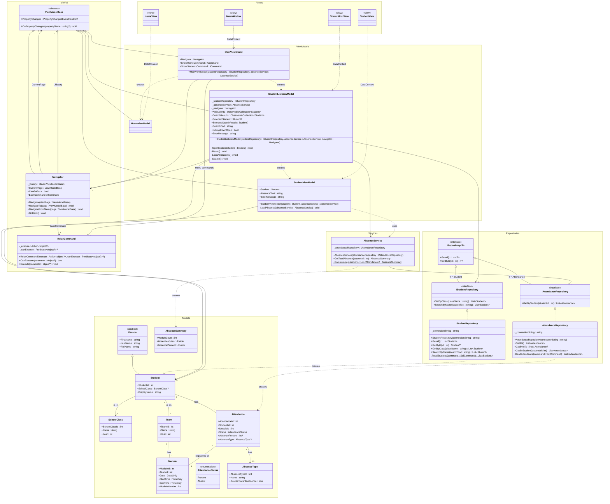

# Design Class Diagram (DCD)

LLD-artefakt, derfor på engelsk med de faktiske navne fra koden. Se [Ordliste.md](Ordliste.md) for
koblingen til domænemodellen.

Notation som Larman (s. 250): `visibility name : Type` for attributter og
`visibility Method(param : Type) : ReturnType` for metoder. `+` public, `-` private, `#` protected,
understreget = static, `<<abstract>>` / `<<interface>>` som stereotyper.

## Noter

- **Relationerne mellem modelklasserne er de samme som i domænemodellen.** I koden er nogle af dem
  kun implementeret som id-attributter (`Module.TeamId`, `Attendance.StudentId`,
  `Attendance.ModuleId`) og ikke som objektreferencer. Derfor har de ingen navigationspil.
  Elev–Hold findes kun i databasen (koblingstabellen `StudentTeam`).
- **`Student.SchoolClass` er `SchoolClass?` i koden**, men i databasen er `SchoolClassId` NOT NULL.
  Repositoriet sætter den altid, så multipliciteten er 1 som i domænemodellen.
- **Views** har ingen egne medlemmer ud over `InitializeComponent()`. Koblingen til ViewModel sker via
  `DataContext` og DataTemplates i `App.xaml`.
- `MainViewModel` opretter `HomeViewModel` og `StudentListViewModel` og giver dem til `Navigator`
  via menukommandoerne, men gemmer dem ikke selv i felter.
