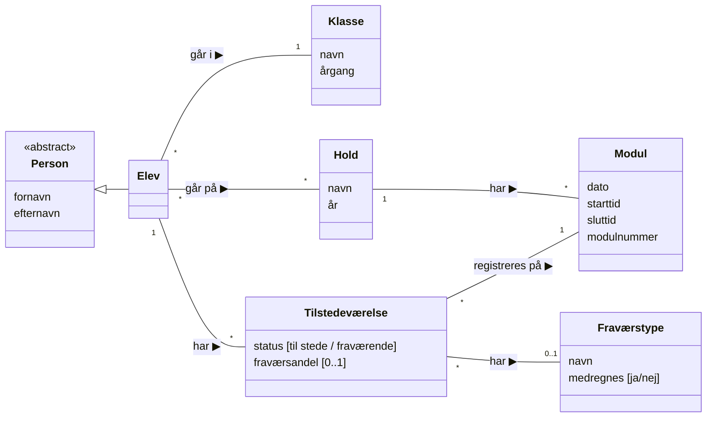

# Domænemodel

HLD-artefakt, derfor på dansk.

Modellen dækker de begreber, Elever-delen af appen bruger. Medarbejder, Rolle, Fag og Uddannelse
fra den oprindelige domænemodel er ikke med endnu.

## Læsevejledning

- ▶ viser læseretningen: "Elev går i Klasse", "Tilstedeværelse registreres på Modul".
- **fraværsandel [0..1]** kan være tom. Er den tom ved fravær, tæller fraværet som et helt modul (100 %).
- **status** er enten *til stede* eller *fraværende*. En fraværstype findes kun ved fravær, derfor 0..1.
- **medregnes** angiver, om fravær af denne type tæller med i elevens samlede fravær
  (fx tæller skolerelateret aktivitet ikke med).

## Afvigelser fra den oprindelige domænemodel

- En elev går i præcis **1** klasse (den oprindelige model tillod 1..*).
