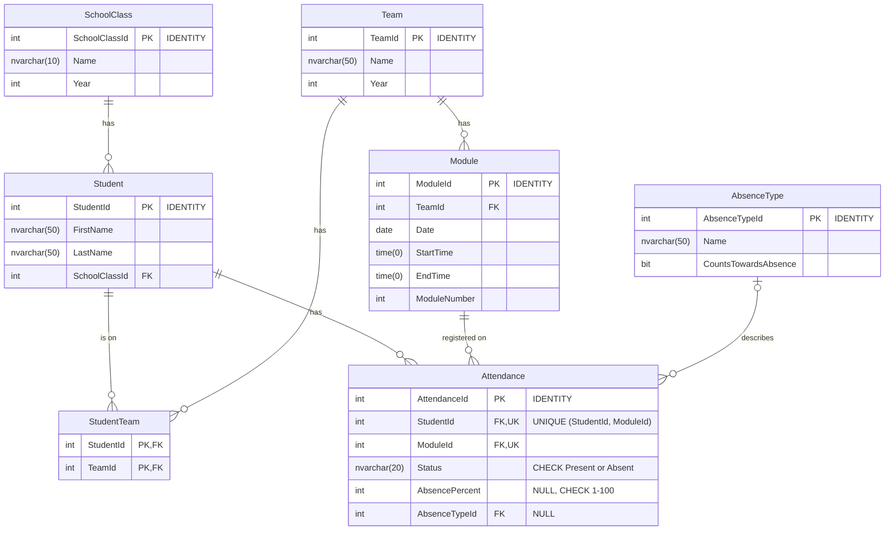

# ER-diagram

LLD-artefakt, derfor på engelsk med de faktiske tabel- og kolonnenavne fra
`Database/CreateDatabase.sql`. Se [Ordliste.md](Ordliste.md) for koblingen til domænemodellen.

Notation: crow's foot. `||` = præcis én, `|o` = nul eller én, `o{` = nul eller flere.

## NULL og unikhed

- **Alle kolonner er NOT NULL**, undtagen dem der er markeret `"NULL"`:
  `Attendance.AbsencePercent` og `Attendance.AbsenceTypeId`.
- **Primærnøgler** er unikke. Surrogatnøgler (`IDENTITY`) bruges, fordi navne kan ændre sig og
  ikke er unikke; id'et er stabilt over tid.
- **`UK`** markerer `UNIQUE (StudentId, ModuleId)` i `Attendance`: en elev har højst én registrering
  pr. modul.
- `StudentTeam` har en sammensat primærnøgle `(StudentId, TeamId)`, så en elev kun kan stå på et hold én gang.

## Referentiel integritet (sletning)

Alle fremmednøgler bruger SQL Servers standard, **`ON DELETE NO ACTION`**: en række kan ikke slettes,
så længe andre rækker refererer til den.

| Fremmednøgle | Ved sletning af ... |
|---|---|
| `Student.SchoolClassId` → `SchoolClass` | en klasse: afvises, hvis klassen har elever |
| `StudentTeam.StudentId` → `Student` | en elev: afvises, hvis eleven står på hold |
| `StudentTeam.TeamId` → `Team` | et hold: afvises, hvis holdet har elever |
| `Module.TeamId` → `Team` | et hold: afvises, hvis holdet har moduler |
| `Attendance.StudentId` → `Student` | en elev: afvises, hvis eleven har registreringer |
| `Attendance.ModuleId` → `Module` | et modul: afvises, hvis modulet har registreringer |
| `Attendance.AbsenceTypeId` → `AbsenceType` | en fraværstype: afvises, hvis den er brugt |

**Begrundelse:** Fraværshistorik er grundlaget for appen og må ikke forsvinde ved en fejl. Appen
skriver ikke til databasen; data kommer fra Lectio. Skal en elev slettes (fx af GDPR-hensyn), sker
det bevidst i rækkefølgen `Attendance` → `StudentTeam` → `Student`.

## Normalisering

- Alle attributter er atomare (fx fornavn og efternavn i hver sin kolonne).
- Databasen er i 3. normalform: hver ikke-nøgle-kolonne afhænger kun af hele nøglen.
  Klassens navn og årgang står kun i `SchoolClass`, og fraværstypens navn kun i `AbsenceType`.

## Fra domænemodel til tabeller

- **Person** er abstrakt og har ingen tabel. Dens attributter ligger i `Student`.
- **Status** er gemt som tekst med en `CHECK`-constraint i stedet for en egen tabel, fordi der kun er
  to faste værdier.
- **Elev går på Hold** (mange-til-mange) er opløst i koblingstabellen `StudentTeam`.
- **Samlet fravær** (`AbsenceSummary`) gemmes ikke; det beregnes af `AbsenceService`.
