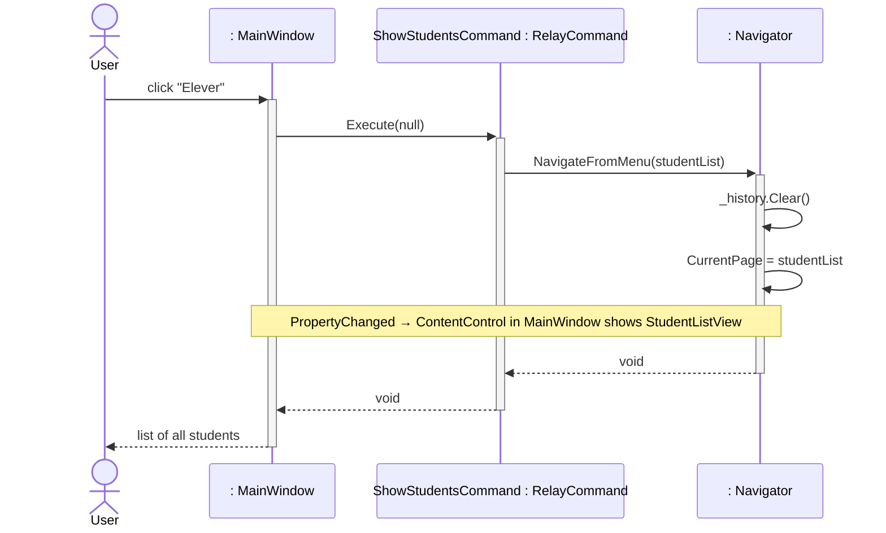
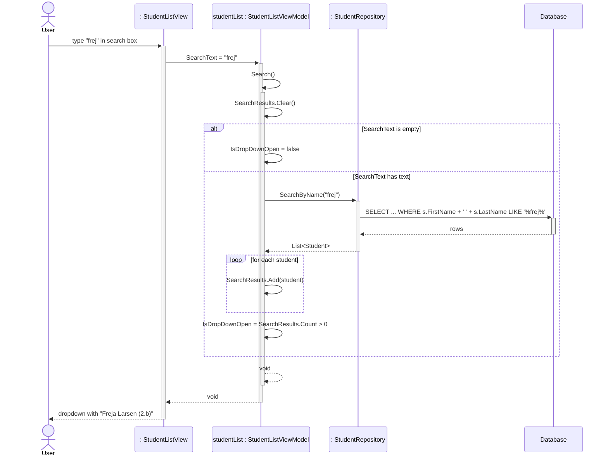
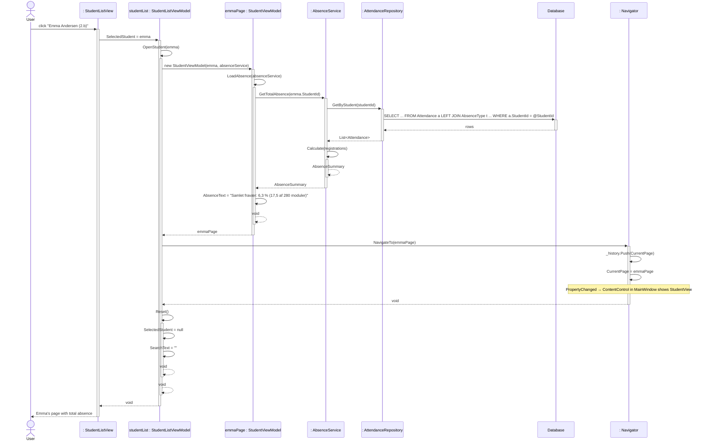
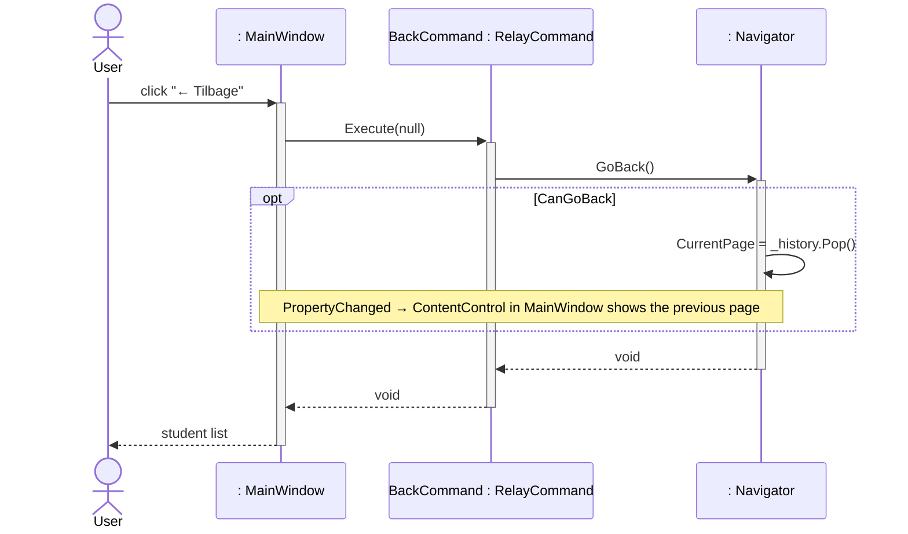

# Sekvensdiagrammer (design)

LLD-artefakter, derfor på engelsk med de faktiske klasse- og metodenavne. Der er ét diagram pr.
systemoperation fra SSD'et (se [Ordliste.md](Ordliste.md)):

| Systemoperation (SSD) | Sekvensdiagram |
|---|---|
| visElever() | [SD1 – ShowStudents](#sd1--showstudents) |
| søgElev(tekst) | [SD2 – SearchStudent](#sd2--searchstudent) |
| vælgElev(elev) | [SD3 – SelectStudent](#sd3--selectstudent) |
| gåTilbage() | [SD4 – GoBack](#sd4--goback) |

Alle deltagere findes i [DCD.md](DCD.md). `Database` er SQL Server-databasen `GymnasieProjektDB`.
Sætninger som `SearchText = "frej"` er WPF-bindinger, der kalder property-setteren.

## SD1 – ShowStudents

**Start:** Brugeren klikker på "Elever" i menuen. **Slut:** Elevlisten vises, og historikken er tom.

## SD2 – SearchStudent

**Start:** Brugeren skriver "frej" i søgefeltet. **Slut:** Dropdownen viser de elever, hvis navn
indeholder teksten.

## SD3 – SelectStudent

**Start:** Brugeren klikker på "Emma Andersen (2.b)" i elevlisten. **Slut:** Emmas side vises med
hendes samlede fravær, og elevlisten er nulstillet.

Vælges eleven i stedet i søgedropdownen, sætter bindingen `SelectedSearchResult`. Setteren lukker
dropdownen (`IsDropDownOpen = false`) og kalder derefter `OpenStudent(student)`, så resten er det samme.

## SD4 – GoBack

**Start:** Brugeren klikker på "← Tilbage" på en elevs side. **Slut:** Den forrige side (elevlisten)
vises igen.

Knappen er grå, når `CanGoBack` er false (`RelayCommand.CanExecute`), så `opt` er normalt sand.
